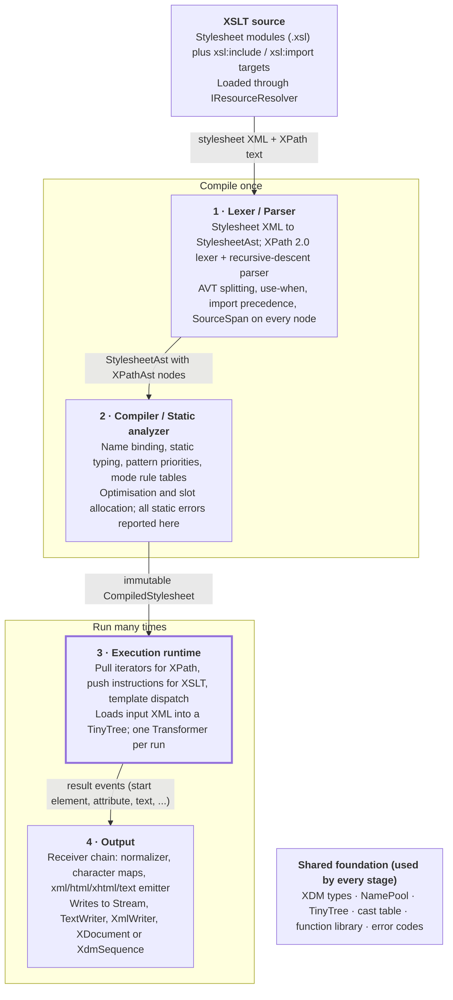
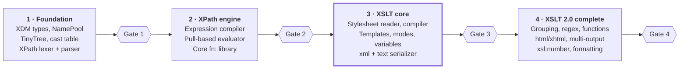

# XTransform — XSLT 2.0 Transformation Engine for .NET: Implementation Design

Status: Draft · Last updated 2026-11-20 · Owner: Stephen Fager

> This file is the repository copy of the design doc and is now the source of truth.
> Engineering decisions made after the design (gate criteria, test-suite pins, error model,
> versioning) live in [decisions.md](decisions.md). Core type signatures live in
> [interfaces.md](interfaces.md).

## Overview and scope

We are building a managed, XSLT 2.0–conformant transformation engine for .NET, structured as a four-stage pipeline: parse, compile, execute, serialize. The built-in `System.Xml.Xsl.XslCompiledTransform` only supports XSLT 1.0 and XPath 1.0, which is the gap this engine fills.

**Target specifications**

| Spec | Version | Notes |
| --- | --- | --- |
| XSLT | 2.0 (W3C Rec, Jan 2007) | Basic XSLT processor conformance first; schema-aware in v2 |
| XPath | 2.0 | Full expression language, including `for`, `if`, `some`/`every`, sequence and type operators |
| XQuery 1.0 and XPath 2.0 Data Model (XDM) | 1.0 | Sequences, atomic values, node identity |
| XPath Functions and Operators | 1.0 | `fn:` library, including regex, date/time, collations |
| XSLT and XQuery Serialization | 1.0 | `xml`, `html`, `xhtml`, `text` output methods |

**Goals**

- Pass the W3C XSLT 2.0 basic-conformance tests that do not require schema awareness.
- Compile once, run many times: a compiled stylesheet is immutable and thread-safe.
- Predictable performance on large inputs, with a path to streaming-friendly execution later.
- A clean public API that feels native to .NET (`XmlReader`, `Stream`, `TextWriter`, `XNode` in and out).

**Non-goals for v1**

- Schema-aware processing, planned for v2 (`xsl:import-schema`, typed validation).
- XSLT 3.0 features (streaming, maps, `xsl:iterate`, higher-order functions).
- Code generation to IL; v1 interprets a compiled expression tree, and IL emission is a later optimization.

## Architecture

The engine is a strict pipeline: each stage consumes the previous stage's output and never reaches back. Stages 1–2 run once per stylesheet; stages 3–4 run once per transformation.



The runtime is highlighted because it is the only stage that touches input documents and the only one with mutable state.

**Solution layout**

| Project | Contents |
| --- | --- |
| `XTransform.Xdm` | Item, node, atomic value, sequence types; NamePool; TinyTree; cast table |
| `XTransform.XPath` | XPath lexer, parser, AST, expression compiler, function library |
| `XTransform.Xslt` | Stylesheet reader, XSLT compiler, instructions, template dispatch |
| `XTransform.Serialization` | Receivers, emitters, character maps, indenting |
| `XTransform` | Public API (`XsltCompiler`, `XsltExecutable`, `XsltTransformer`) |
| `XTransform.Compat` | Drop-in `XslCompiledTransform` replacement |
| `XTransform.Cli` | `dotnet tool` command-line runner |
| `XTransform.Tests` / `XTransform.Conformance` | Unit tests; W3C suite harness |
| `XTransform.Benchmarks` | BenchmarkDotNet scenarios |

Project references flow one way: `Xdm` ← `XPath` ← `Xslt` → `Serialization` → `Xdm`; `XTransform` ← `Xslt`; `Compat` and `Cli` ← `XTransform`.

## Data model (XDM) and type system

Everything in XPath 2.0 is a sequence of items, so the core runtime type is an immutable `XdmSequence`, never a single node or string. Getting this layer right first makes every later stage simpler.

**Core types**

| .NET type | XDM concept | Notes |
| --- | --- | --- |
| `XdmItem` (abstract) | item() | Base for nodes and atomic values |
| `XdmNode` | node() | Wraps an internal tree node; exposes kind, name, string value, typed value, document order key |
| `XdmAtomicValue` | xs:anyAtomicType | Struct-like value + `XdmTypeCode` |
| `XdmSequence` | item()* | Immutable; backed by empty / singleton / array / lazy enumerator |
| `SequenceType` | e.g. `xs:integer+` | Item type + occurrence indicator, used by the compiler |

**Node storage.** Use a purpose-built, read-only tree ("TinyTree" style: parallel arrays of node kind, name code, parent, next sibling, text offset) rather than `XmlDocument` or `XDocument`. It gives O(1) document-order comparison, low allocation, and fast axis navigation. Provide an adapter so an existing `XDocument` or `XmlReader` can be loaded into it.

**Names.** Intern every QName in a `NamePool` and compare by integer code. Element and attribute name tests then become integer comparisons.

**Atomic types for v1.** `xs:string`, `xs:boolean`, `xs:decimal`, `xs:integer`, `xs:double`, `xs:float`, `xs:date`, `xs:time`, `xs:dateTime`, `xs:duration`, `xs:dayTimeDuration`, `xs:yearMonthDuration`, `xs:QName`, `xs:anyURI`, `xs:untypedAtomic`, plus the `g*` date fragments and `xs:hexBinary` / `xs:base64Binary`. Map `xs:decimal` to `System.Decimal` with an overflow fallback, and `xs:integer` to `long` with promotion to `BigInteger`.

**Type promotion and casting.** Implement the XPath casting table as a single static matrix (`CastTable[from, to]`) plus numeric and URI promotion rules. Atomization and `xs:untypedAtomic` handling live in one place so general comparisons and function calls behave consistently.

## Stage 1 — Lexer and parser

There are two grammars to parse: the stylesheet itself (XML) and the XPath 2.0 expressions and patterns embedded in its attributes. The output of this stage is a syntax tree with source locations; no semantic checks happen here.

**1a. Stylesheet reader**

1. Read the stylesheet with `XmlReader` (DTD processing off, line info on) into a lightweight `StylesheetNode` tree that keeps line/column and in-scope namespaces per element.
2. Recognise XSLT elements by namespace (`http://www.w3.org/1999/XSL/Transform`); everything else is a literal result element or an extension element.
3. Split attribute value templates (AVTs) such as `href="{$base}/x"` into literal and expression parts, honouring `{{` / `}}` escapes.
4. Apply `use-when` (static evaluation against system properties) and strip whitespace-only text per `xml:space`.
5. Resolve `xsl:include` and `xsl:import` recursively, recording import precedence; detect cycles.

**1b. XPath lexer**

XPath 2.0 is not context-free at the token level: `div`, `for`, `item`, `*` and `-` mean different things depending on the previous token. Use a hand-written lexer with a small state machine that tracks whether the next token is an operator or an operand.

- Token kinds: names (NCName, QName, `prefix:*`, `*:local`), literals (string, integer, decimal, double), operators, keywords, punctuation.
- Handle `(: nested :)` comments and the `-` ambiguity (`a-b` is a name, `a - b` is subtraction).
- Every token carries an offset so errors point at the exact character in the attribute.

**1c. XPath parser**

A hand-written recursive-descent parser, one method per grammar production, following the precedence ladder in the spec:

`Expr` → `ExprSingle` (`for` / `some` / `every` / `if` / `OrExpr`) → `and` → comparison → `to` → additive → multiplicative → `union` → `intersect`/`except` → `instance of` → `treat as` → `castable as` → `cast as` → unary → path → step / filter → primary.

Patterns (`match`, `xsl:key/@match`, `xsl:number/@count`) use a restricted grammar and get their own parse entry point that produces a `Pattern` AST rather than an expression.

**Why hand-written, not ANTLR?** Context-sensitive tokenisation, precise error messages and zero runtime dependency matter more than grammar-file convenience. ANTLR remains an option for prototyping.

**Output:** `StylesheetAst` (instructions, declarations, templates) where every expression slot holds an `XPathAst` node with a `SourceSpan`.

## Stage 2 — Compiler and static analyzer

The compiler turns the AST into an immutable, executable `CompiledStylesheet` and reports every static error (`XTSE*`, `XPST*`, `XPTY*` where detectable) before any input is touched. It runs as a sequence of passes over the tree.

**Passes**

1. **Declaration collection** — gather templates, named templates, modes, global variables/params, functions (`xsl:function`), keys, attribute sets, decimal formats, output definitions, character maps, namespace aliases. Resolve import precedence and detect duplicates (`XTSE0630`, `XTSE0770`).
2. **Name and scope resolution** — bind every QName to its namespace; bind variable references to their declaration slot (local slot index or global id); bind function calls to built-ins, `xsl:function`s or extension functions, checking arity (`XPST0017`).
3. **Static type inference** — compute a `SequenceType` for every expression bottom-up. Use it to insert implicit atomization, `xs:untypedAtomic` conversion and function-conversion rules, and to report errors that are certain to fail (`XPTY0004`).
4. **Template rule compilation** — compile each `match` pattern; compute default priority per spec (e.g. `foo` = 0, `ns:*` = -0.25, `node()` = -0.5, complex patterns = 0.5); split union patterns into separate rules; build a per-mode rule table.
5. **Optimization** — constant folding, dead `if` branch removal, inlining small functions and single-use variables, loop-lifting invariants out of `for` and `xsl:for-each`, rewriting `//x` to `descendant::x` where safe, and turning `count(x) > 0` into `exists(x)`.
6. **Slot allocation** — assign each local variable a numeric frame slot so the runtime uses arrays, not dictionaries.
7. **Code generation** — emit the executable tree (see Stage 3). Each node keeps its `SourceSpan` for runtime error reporting.

**Key compiler data structures**

| Structure | Purpose |
| --- | --- |
| `StaticContext` | In-scope namespaces, default element/function namespace, base URI, collations, variable scopes |
| `ModeTable` | Per mode: rules indexed by node kind and name code, sorted by precedence then priority |
| `ExpressionNode` | Compiled expression, with static type, dependency flags (context item, position, last, focus-free) |
| `CompiledStylesheet` | Immutable root; holds modes, globals, functions, keys, output definitions; safe to share across threads |

**Dependency flags** on every expression (depends on context item, position, last(), local variables, current-group) drive both optimisation and lazy evaluation decisions at runtime.

## Stage 3 — Execution runtime

The runtime is a tree-walking interpreter over compiled expression and instruction nodes, with pull-based (lazy) evaluation for XPath and push-based evaluation for XSLT instructions. One `Transformer` instance per run holds all mutable state; the `CompiledStylesheet` is never mutated.

**Evaluation model**

- **Pull (XPath).** Each `ExpressionNode` implements `Iterate(DynamicContext) → IXdmIterator` and, where cheaper, `EvaluateItem` and `EffectiveBooleanValue`. Path expressions, filters and `for` stay lazy, so `(//item)[1]` stops after the first match.
- **Push (XSLT).** Instructions implement `Execute(DynamicContext, IResultReceiver)`. Literal result elements, `xsl:element`, `xsl:copy` etc. emit events (start element, attribute, namespace, text, end element) to a receiver rather than building nodes.
- **Temporary trees.** When a variable holds constructed content, a `TreeBuilder` receiver captures it into a new tree; otherwise output goes straight to the serializer.

**Dynamic context**

| Component | Implementation |
| --- | --- |
| Focus | Context item, position, size (size computed lazily for `last()`) |
| Local variables | `XdmSequence[]` frame indexed by compiler slot |
| Globals | Evaluated lazily on first use, cached, with cycle detection (`XTDE0640`) |
| Current template rule / mode | For `xsl:apply-imports` and `xsl:next-match` |
| Grouping | Current group and grouping key for `xsl:for-each-group` |
| Regex | Current captured groups for `xsl:analyze-string` / `regex-group()` |
| Output state | Current receiver, plus the principal and secondary (`xsl:result-document`) destinations |

**Template dispatch.** `xsl:apply-templates` looks up the mode's rule table by node kind and name code, then tests candidate patterns in precedence/priority order. Patterns are matched bottom-up (test the node, then its parent) to avoid evaluating expressions from the root. Conflicts resolve to the last rule in document order, optionally warning (`XTRE0540`).

**XSLT 2.0 specifics to get right**

- `xsl:for-each-group` with `group-by`, `group-adjacent`, `group-starting-with`, `group-ending-with`.
- `xsl:sequence` returning atomic values and existing nodes without copying.
- Tunnel parameters on `xsl:apply-templates` / `xsl:call-template` / `xsl:next-match`.
- `xsl:perform-sort` and `xsl:sort` with collations, `data-type` and stable sort.
- `xsl:analyze-string` using XPath regex semantics (translate to .NET `Regex` carefully: character class subtraction, `\p{Is...}` blocks, no lookaround).
- `xsl:key` indexes built lazily per document and key name, as `Dictionary<AtomicKey, List<XdmNode>>`.
- `xsl:number` and `format-number`, `format-date`/`format-dateTime` picture strings.

**Errors and resources.** Dynamic errors become `XsltDynamicException` with error QName, source span and the current template stack. Document loading for `doc()` / `document()` / `collection()` goes through a pluggable `IResourceResolver`, with a per-run document cache so node identity is stable. Support a `CancellationToken` and an optional recursion-depth limit to protect against runaway stylesheets.

## Stage 4 — Output and serialization

Output is a chain of `IResultReceiver` filters ending in a writer, so the runtime never knows whether it is producing a file, a string or an in-memory tree.

**Receiver pipeline (principal result)**

1. `SequenceNormalizer` — applies the XSLT 2.0 sequence normalization rules: adjacent atomic values joined with a space, attribute/namespace placement checks (`XTDE0410`, `XTDE0420`), namespace fixup.
2. `CharacterMapFilter` — applies `xsl:character-map` substitutions.
3. `MethodEmitter` — one of `XmlEmitter`, `HtmlEmitter`, `XhtmlEmitter`, `TextEmitter`, chosen from `xsl:output/@method` (default: `html` if the first element is `<html>` with no namespace, else `xml`).
4. `IndentFilter` — optional, when `indent="yes"`.
5. Sink — `TextWriter`, `Stream` (with encoding), or a `TreeBuilder` for in-memory results.

**Serialization parameters to support:** `method`, `encoding`, `indent`, `omit-xml-declaration`, `standalone`, `doctype-public`, `doctype-system`, `cdata-section-elements`, `escape-uri-attributes`, `include-content-type`, `media-type`, `normalization-form`, `undeclare-prefixes`, `use-character-maps`, `byte-order-mark`, `version`.

**Secondary results.** `xsl:result-document` resolves its `href` against the base output URI and asks an `IResultDocumentHandler` for a destination. Writing the same URI twice is `XTDE1490`.

**Alternative sinks for .NET consumers:** `XmlWriter` (to plug into existing pipelines), `XDocument` / `XmlDocument` builders, and a raw `XdmSequence` result when the caller wants the value of the initial template rather than serialized text.

## Function library and extensibility

Around 110 `fn:` functions plus the XSLT-specific ones make up the bulk of the implementation effort after the core pipeline. Register them through one `FunctionLibrary` abstraction so built-ins, `xsl:function` and .NET extensions all resolve the same way.

| Group | Examples | Notes |
| --- | --- | --- |
| Accessors and nodes | `node-name`, `data`, `base-uri`, `root`, `name`, `local-name` | |
| Strings | `concat`, `substring`, `string-join`, `normalize-space`, `upper-case`, `translate` | Unicode code points, not UTF-16 units |
| Regex | `matches`, `replace`, `tokenize` | Shared XPath-regex translator with `xsl:analyze-string` |
| Numeric | `abs`, `round`, `round-half-to-even`, `sum`, `avg`, `min`, `max` | Type promotion rules |
| Date/time | `current-dateTime`, component extractors, timezone adjust | Stable `current-dateTime` per transformation |
| Sequences | `distinct-values`, `index-of`, `insert-before`, `subsequence`, `reverse`, `deep-equal` | |
| Context | `position`, `last`, `current`, `current-group`, `current-grouping-key` | |
| XSLT-only | `document`, `key`, `format-number`, `format-date`, `generate-id`, `unparsed-text`, `system-property`, `regex-group` | |

**Extension points**

- `IExtensionFunction` — register a .NET delegate under a namespace URI with a declared signature (`SequenceType` per argument and result) so the compiler can type-check calls.
- `IResourceResolver` — controls `doc()`, `document()`, `unparsed-text()`, `xsl:include`/`xsl:import`. Default denies network access.
- `IResultDocumentHandler` — where `xsl:result-document` output goes.
- `IMessageListener` — receives `xsl:message` (with `terminate="yes"` raising `XTMM9000`).
- `ICollationProvider` — maps collation URIs to `StringComparer` / `CompareInfo`.

## Public API surface

The API follows a compile-once / run-many shape: an immutable `XsltExecutable` is cached and shared, and a cheap `XsltTransformer` is created per run.

```csharp
var compiler = new XsltCompiler(new XsltCompilerOptions
{
    ResourceResolver = new FileSystemResolver(baseDir),
    TreatWarningsAsErrors = false
});

// Compile once (throws XsltStaticException with all static errors)
XsltExecutable exe = compiler.Compile(new Uri("file:///styles/invoice.xsl"));

// Run many times, concurrently
XsltTransformer t = exe.CreateTransformer();
t.SetParameter(new QName("currency"), XdmAtomicValue.String("USD"));
t.InitialMode = new QName("summary");          // optional
t.MessageListener = msg => logger.LogInformation("{Msg}", msg);

await using var input = File.OpenRead("invoice.xml");
await using var output = File.Create("invoice.html");
await t.TransformAsync(input, output, cancellationToken);
```

**Inputs:** `Stream`, `TextReader`, `XmlReader`, `XNode`, `XmlNode`, `XdmNode`, or none (start from an initial named template set on the transformer).

**Outputs:** `Stream`, `TextWriter`, `XmlWriter`, `XDocument`, or `XdmSequence` for raw results.

**Diagnostics:** `XsltStaticException.Errors` lists every static error with code, message, file, line and column. Runtime errors surface as `XsltDynamicException` with the template call stack.

**Packaging:** the MIT-licensed `XTransform` NuGet package, developed at [github.com/sfager/xtransform](https://github.com/sfager/xtransform), multi-targeting `net8.0` and `netstandard2.0` (hosts down to .NET Framework 4.6.2), plus a `dotnet tool` CLI (`xtransform -s:in.xml -xsl:style.xsl -o:out.html`) for testing and scripting. On `netstandard2.0` the only extra dependencies are Microsoft's BCL polyfills (`Microsoft.Bcl.AsyncInterfaces`, `System.Memory`); hot paths use `#if NET8_0_OR_GREATER` for span-based and `FrozenDictionary` optimisations, with a plain fallback. Because .NET Framework 4.6.2 consumes `netstandard2.0` through facade assemblies that are known to cause binding issues before 4.7.2, also ship an explicit `net462` target from the same source and run CI on Windows against it.

### Backwards-compatible mode (XSLT 1.0)

Existing XSLT 1.0 stylesheets must run unchanged, at two levels:

1. **Language level.** A stylesheet with `version="1.0"` runs in backwards-compatible processing mode as the XSLT 2.0 spec defines it: XPath 1.0 compatibility mode (first-item semantics for `string()`/`number()` on sequences, numeric comparisons via `xs:double`, no `XPTY0004` on many type mismatches), and 1.0 behaviour for `xsl:value-of` and AVTs.
2. **API level.** A drop-in `XTransform.Compat.XslCompiledTransform` with the same members as `System.Xml.Xsl.XslCompiledTransform` (`Load`, `Transform`, `OutputSettings`, `XsltArgumentList` parameters and extension objects, `XmlResolver`, `XsltSettings`). Swapping the namespace is the whole migration.

Known gaps to document rather than emulate: `msxsl:script` (embedded C#) is not supported, and behaviour that depends on `XslCompiledTransform` bugs is not reproduced. `msxsl:node-set()` is supported as an alias.

## Testing and conformance

Conformance is measured against the W3C test suites, run in CI on every commit, with a published pass-rate per feature area.

| Layer | What | How |
| --- | --- | --- |
| Unit | Lexer tokens, parser ASTs, cast table, each `fn:` function | NUnit, AAA pattern, table-driven `[TestCase]` |
| XPath conformance | QT3 test suite (XPath 2.0 subset) | Harness reads the catalog XML, filters by spec dependencies (see decisions.md) |
| XSLT conformance | W3C XSLT test suite (XSLT 2.0 tests, non-schema-aware) | Same harness; compare serialized output with XML canonical comparison or `assert` expressions |
| Differential | Same stylesheet on this engine vs. a reference processor | Golden-file diffs on real-world stylesheets (DocBook, DITA, your own integration XSLTs) |
| Performance | Large-input and deep-recursion scenarios | BenchmarkDotNet; track allocations and throughput per release |
| Fuzzing | Random XPath expressions and stylesheets | SharpFuzz on the parser; must never crash, only report errors |

**Error-code tests matter as much as output tests.** Many suite cases expect a specific error (`XTSE0010`, `XPTY0004` ...); the harness asserts the error QName, not only that something failed.

**Backwards-compatibility parity.** A corpus of XSLT 1.0 stylesheets runs through both `System.Xml.Xsl.XslCompiledTransform` and the compat shim, with outputs compared; every intentional difference is listed in the docs.

**Licensing.** The W3C test suites are not vendored into the repository; the harness downloads a pinned commit at test time, keeping the repo under its MIT licence.

## Roadmap

Build bottom-up: the XDM and XPath layers are usable and testable on their own before any XSLT code exists, which keeps each phase shippable.



Throughout: NUnit unit tests, fuzzing, BenchmarkDotNet; NuGet package and CLI preview from phase 3. Gate criteria, with numbers, are in [decisions.md](decisions.md#phase-gates). Dates are not set yet; size each phase once phase 1 gives a velocity baseline.

## Risks and decisions

| Risk | Impact | Mitigation |
| --- | --- | --- |
| XPath regex vs .NET `Regex` semantics differ | Wrong matches in `matches`, `replace`, `tokenize`, `xsl:analyze-string` | Dedicated translator + QT3 regex tests; reject unsupported constructs explicitly |
| Decimal and date/time edge cases (precision, timezones, leap seconds) | Conformance failures | Own `XsdDecimal` / `XsdDateTime` types rather than raw `DateTime` |
| Interpreter too slow on large documents | Adoption | TinyTree, name pool, lazy iterators first; IL compilation behind the same expression interface later |
| Spec surface is large (function library, `xsl:number`, formatting) | Schedule | Prioritise by usage in real stylesheets; track suite pass-rate per area |
| Unbounded recursion / huge outputs | Stack overflow, DoS | Depth limit, trampolining for tail-recursive templates, cancellation |

**Decisions (2026-11-20)**

| Question | Decision |
| --- | --- |
| Schema-aware processing | Deferred to v2; v1 targets basic XSLT processor conformance |
| API style | .NET-idiomatic, not modelled on another processor's API |
| XSLT 1.0 compatibility | Yes: backwards-compatible processing mode plus a drop-in `XslCompiledTransform` shim |
| Target frameworks | `net8.0` and `netstandard2.0`, supporting .NET Framework 4.6.2+ (plus explicit `net462`) |
| Distribution | Open source, MIT licence |
| Name and repository | XTransform, [github.com/sfager/xtransform](https://github.com/sfager/xtransform) |
